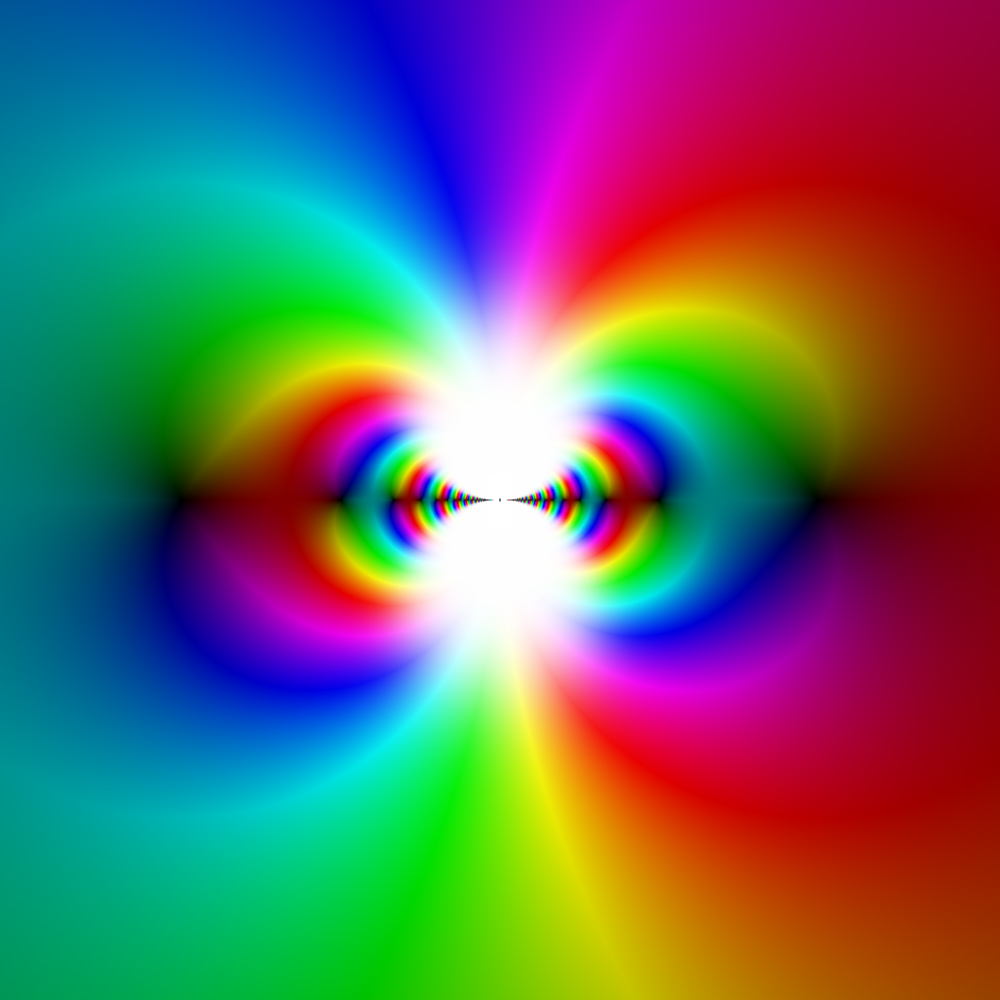
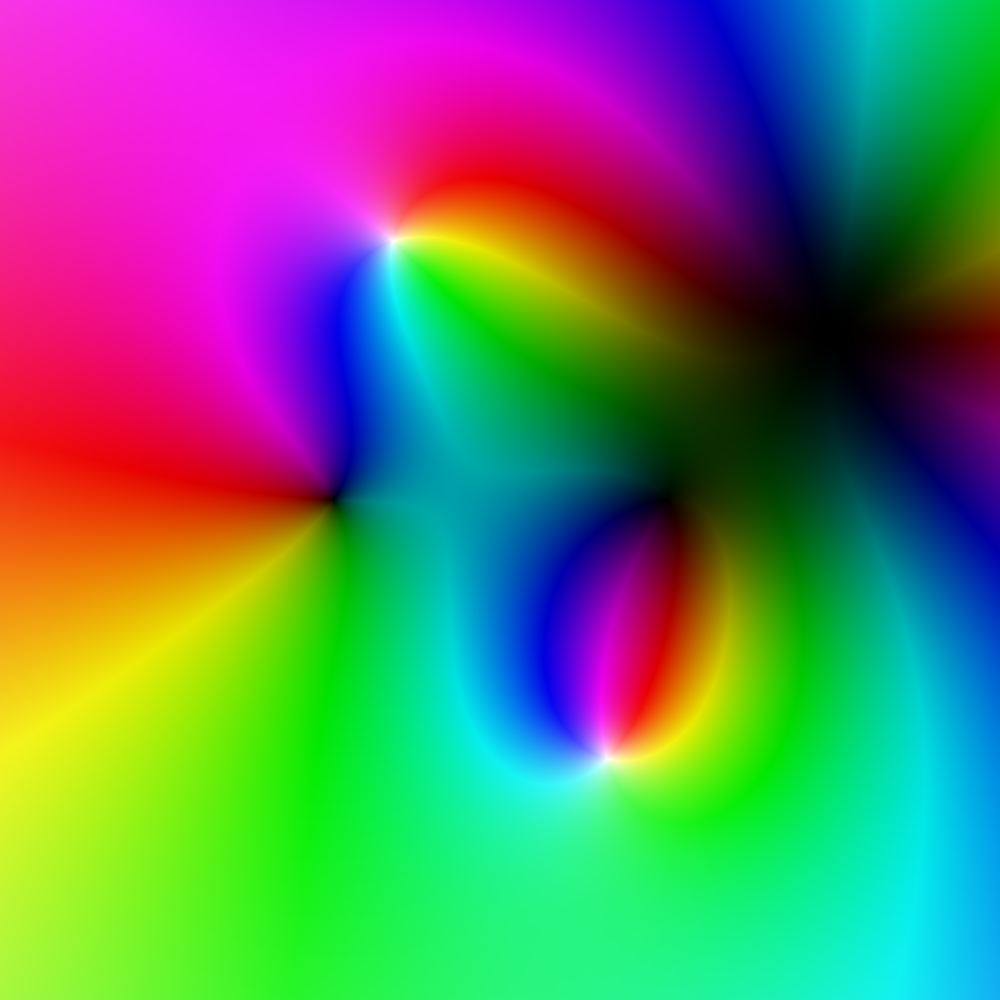

# Complex Grid Visualiser

Feast your eyes! As I present a beautiful way to portray your favorite topic in math.



*`sin(1/z)` — the zeros sit at 1/(nπ), which crowd towards the origin, explaining why the structure gets finer until the pixels give out.*

## What am I looking at?

Simple. Two things:

* **Brightness** — the modulus
* **Hue** — the argument

The black spots you see are where the function hits zero, and the white means the function blows up (a pole). The brightness is on a scale of 0–1, so an infinite modulus caps at 1. Calculated by the following:

$$v = \frac{r}{1 + r}, \qquad r = |f(z)|$$

The colours represent the argument of f(z) at a point. As you walk once around a zero or a pole, the colours cycle through the full wheel. If the colours cycle twice during that single trip, it's a double zero. Calculated by the following:

$$h = \frac{\arg f(z)}{2\pi} \bmod 1$$

## More images


*`z**5 - 1` — five simple zeros sitting in a pentagon on the unit circle.*



*`(z**2 - 1)*(z - 2 - 1j)**2 / (z**2 + 2 + 2j)` — two simple zeros, a double zero, and two poles.*


*`z**2` — a single zero at the origin, with the colours cycling twice around it.*

## Terminal

```bash
python main.py
```

The visualiser will ask for 3 inputs:

* the bounds for the complex plane:
    * the distance from 0 in the real and imaginary axes
* the resolution of your image:
    * measured in pixels, always a 1:1 ratio
* the function you want to visualise (in terms of z):
    * fortunately, you can type in math functions (e.g. `sin(4*z**2)/cos(pi)`)

## Installation

Simply install numpy and pillow alongside this git:

```bash
git clone https://github.com/<n4ee>/visualising-complex-functions.git
pip install numpy pillow matplotlib
```
